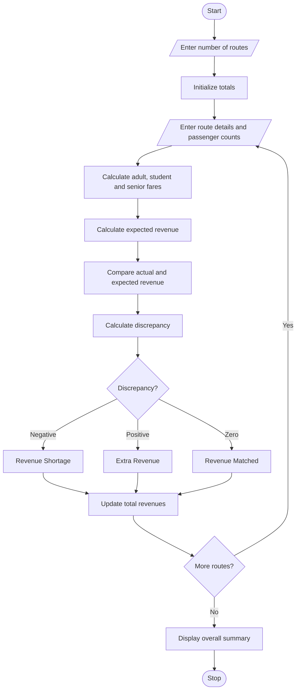

# -Smart-Public-Transport-Fare-Reconciliation
# Case Study: Smart Public Transport Fare Reconciliation

## 1. Problem Statement
Smart Public Transport Fare Reconciliation is a Python program that calculates passenger fares across multiple routes and passenger categories. It calculates expected revenue using category-based discounts, compares it with the actual collected revenue, identifies discrepancies, and displays the overall revenue summary.

## 2. Objectives
- Calculate fares for multiple transport routes.
- Support adult, student, and senior passenger categories.
- Apply discounts to students and senior citizens.
- Calculate expected revenue route-wise.
- Compare expected revenue with actual collected revenue.
- Identify revenue shortage, extra revenue, or matched revenue.

## 3. Assumptions
- Adults pay 100% of the base fare.
- Students receive a 20% discount.
- Senior citizens receive a 10% discount.
- Passenger counts are entered as whole numbers.
- Base fares and collected revenues are entered as non-negative values.
- Discrepancy = Actual Revenue − Expected Revenue.

## 4. Algorithm
1. Start the program.
2. Enter the number of routes.
3. For each route, enter the route name and base fare.
4. Enter adult, student, and senior passenger counts.
5. Enter actual revenue collected.
6. Calculate category-wise fares.
7. Calculate expected revenue.
8. Calculate the discrepancy.
9. Display route-wise reconciliation results.
10. Calculate total expected and collected revenue.
11. Display overall revenue status.
12. Stop.

## 5. Pseudocode

```text
START

INPUT number_of_routes
SET total_expected = 0
SET total_collected = 0

FOR each route
    INPUT route_name
    INPUT base_fare
    INPUT adult_count
    INPUT student_count
    INPUT senior_count
    INPUT actual_revenue

    adult_fare = base_fare
    student_fare = base_fare * 0.80
    senior_fare = base_fare * 0.90

    expected_revenue =
        adult_count * adult_fare +
        student_count * student_fare +
        senior_count * senior_fare

    discrepancy = actual_revenue - expected_revenue

    ADD expected_revenue to total_expected
    ADD actual_revenue to total_collected

    DISPLAY route reconciliation

    IF discrepancy < 0
        DISPLAY "Revenue Shortage"
    ELSE IF discrepancy > 0
        DISPLAY "Extra Revenue"
    ELSE
        DISPLAY "Revenue Matched"
    END IF
END FOR

total_discrepancy = total_collected - total_expected

DISPLAY total_expected
DISPLAY total_collected
DISPLAY total_discrepancy

STOP
```

## 6. Flowchart



## 7. Python Source Code

See `main.py` in this case study folder.

## 8. Test Cases

| Test | Base Fare | Adults | Students | Seniors | Actual Revenue | Expected Revenue |
|---|---:|---:|---:|---:|---:|---:|
| 1 | ₹20 | 30 | 20 | 10 | ₹1080 | ₹1100 |
| 2 | ₹30 | 40 | 10 | 5 | ₹1600 | ₹1575 |
| 3 | ₹10 | 10 | 0 | 0 | ₹100 | ₹100 |

### Test case results

- Test 1: Revenue shortage of ₹20
- Test 2: Extra revenue of ₹25
- Test 3: Revenue matched

## 9. Sample Input

```text
Enter number of routes: 2

Route 1
Enter route name: Route A
Enter base fare: 20
Enter adult passengers: 30
Enter student passengers: 20
Enter senior passengers: 10
Enter actual revenue collected: 1080

Route 2
Enter route name: Route B
Enter base fare: 30
Enter adult passengers: 40
Enter student passengers: 10
Enter senior passengers: 5
Enter actual revenue collected: 1600
```

## 10. Sample Output

```text
========== FARE RECONCILIATION ==========

Route: Route A
Expected Revenue: Rs. 1100.0
Actual Revenue: Rs. 1080.0
Discrepancy: Rs. -20.0
Status: Revenue Shortage

Route: Route B
Expected Revenue: Rs. 1575.0
Actual Revenue: Rs. 1600.0
Discrepancy: Rs. 25.0
Status: Extra Revenue

========== OVERALL SUMMARY ==========
Total Expected Revenue: Rs. 2675.0
Total Collected Revenue: Rs. 2680.0
Total Discrepancy: Rs. 5.0
Overall Status: Extra Revenue
```

## 11. Output Screenshots

Run the Python program and capture the terminal output.

Save your screenshot in this folder as:

`output.png`

## 12. Conclusion

The Smart Public Transport Fare Reconciliation program successfully calculates passenger fares for different categories and multiple routes. It applies passenger discounts, calculates expected revenue, compares actual revenue, identifies discrepancies, and provides an overall revenue summary. This program helps simplify fare management and improve revenue tracking in public transport systems.
